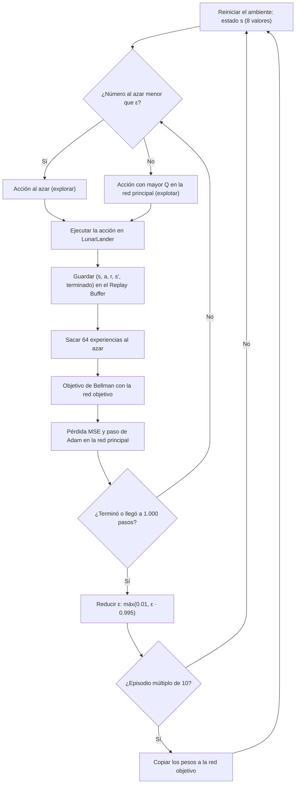
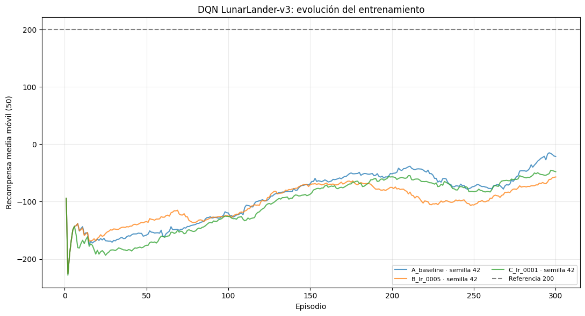
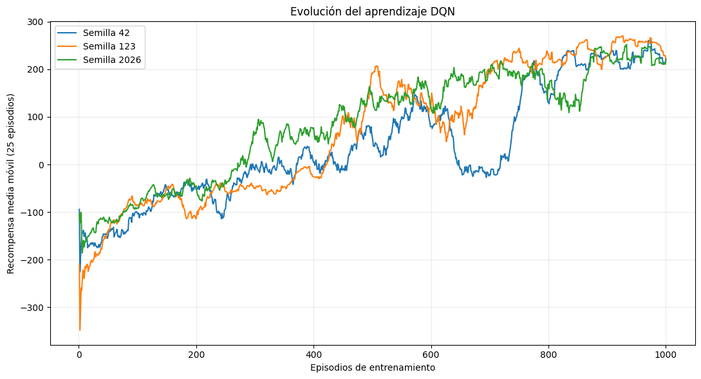
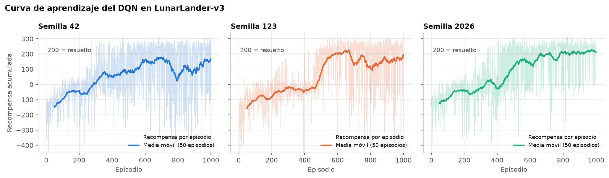
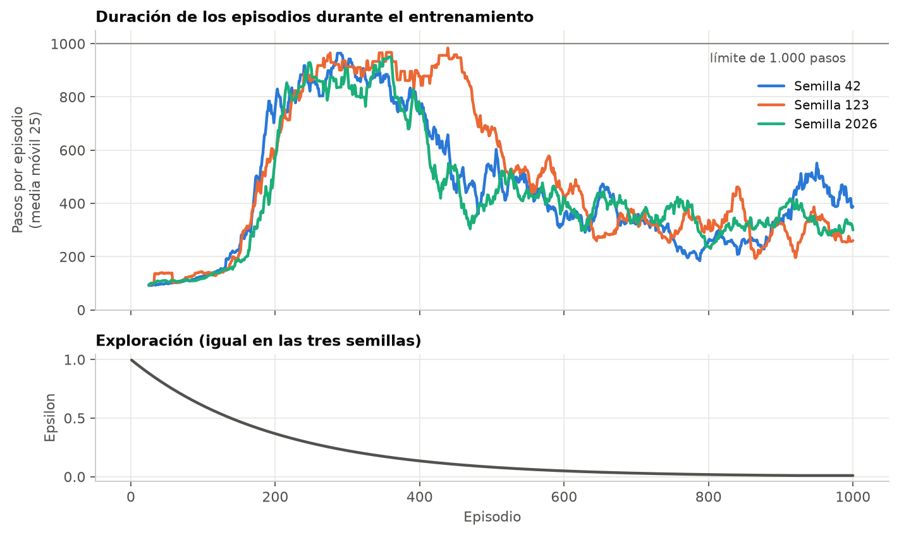
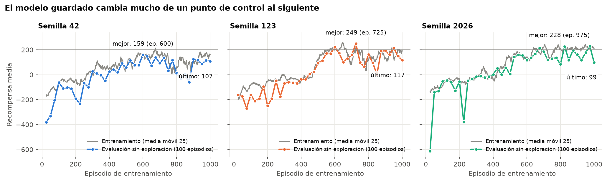
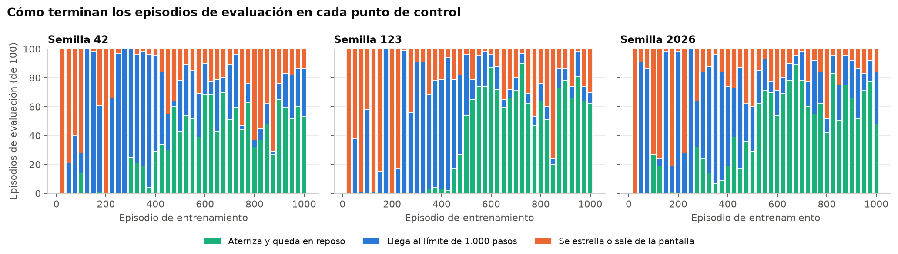
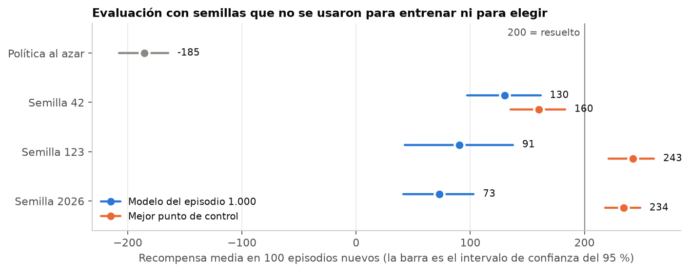
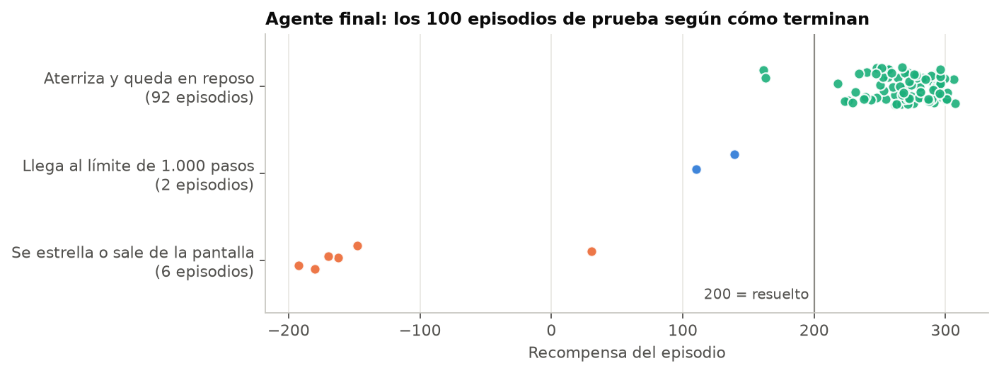

# Taller 2 — Resolver un ambiente nuevo de Gymnasium con DQN

**Grupo 4**

Entrenamos un agente **Deep Q-Network (DQN)** para aterrizar una nave en el ambiente `LunarLander-v3` de Gymnasium. El agente final obtiene una recompensa media de **242.63 ± 102.90** en 100 episodios que no vio durante el entrenamiento, supera los 200 puntos en 90 de ellos y aterriza en 92.

Este README describe el ambiente, el flujo de entrenamiento, la red neuronal, los resultados y lo que aprendimos en el proceso.

---

# 1. Ambiente: LunarLander-v3

El agente controla una nave que debe posarse sobre una plataforma. La plataforma siempre está en las coordenadas (0, 0) y la nave arranca en la parte superior de la pantalla (Farama Foundation, 2024).

Lo elegimos porque no se trabajó en clase y porque se puede resolver con DQN: el estado es un vector de números continuos y las acciones son discretas.

## 1.1 Observaciones

- **Tipo:** `Box`
- **Dimensiones:** `(8,)`, un vector de 8 valores
- **dtype:** `float32`

| Índice | Variable | Rango declarado | Valores que aparecen en la práctica |
|---|---|---|---|
| 0 | Posición horizontal (x) | −2.5 a 2.5 | −0.77 a 0.84 |
| 1 | Posición vertical (y) | −2.5 a 2.5 | −0.07 a 1.60 |
| 2 | Velocidad horizontal | −10 a 10 | −1.25 a 1.41 |
| 3 | Velocidad vertical | −10 a 10 | −1.58 a 0.36 |
| 4 | Ángulo de la nave | −2π a 2π | −1.66 a 1.38 |
| 5 | Velocidad angular | −10 a 10 | −1.34 a 1.51 |
| 6 | Contacto de la pata izquierda con el suelo | 0 a 1 | 0 o 1 |
| 7 | Contacto de la pata derecha con el suelo | 0 a 1 | 0 o 1 |

La última columna es una medición propia: son los percentiles 1 y 99 de cada variable en 500 episodios con acciones al azar (anexo del notebook `Persona_4_Evaluacion_Resultados.ipynb`).

## 1.2 Acciones

- **Tipo:** `Discrete(4)`
- **Dimensiones:** un solo número entero por paso (escalar)
- **dtype:** `int64`

| Acción | Efecto |
|---|---|
| 0 | No hacer nada |
| 1 | Encender el motor de orientación izquierdo |
| 2 | Encender el motor principal |
| 3 | Encender el motor de orientación derecho |

Cada motor solo puede estar encendido o apagado. Por eso las acciones son discretas y el ambiente encaja con DQN, que necesita un valor Q por cada acción posible.

## 1.3 Recompensas

En cada paso el ambiente entrega una recompensa. La recompensa del episodio es la suma de todas (Farama Foundation, 2024):

- Sube cuando la nave se acerca a la plataforma y baja cuando se aleja.
- Sube cuando la nave va más despacio y baja cuando va más rápido.
- Baja cuanto más inclinada esté la nave.
- **+10** por cada pata en contacto con el suelo.
- **−0.03** por cada paso con un motor lateral encendido.
- **−0.3** por cada paso con el motor principal encendido.
- **+100** al final si aterriza de forma segura y **−100** si se estrella.

Un episodio se considera resuelto si suma **200 puntos o más**.

## 1.4 Terminación del episodio

`env.step(action)` devuelve dos señales distintas de fin de episodio.

`terminated=True` cuando ocurre una de estas tres cosas (Farama Foundation, 2024):

1. La nave se estrella: el cuerpo toca el suelo.
2. La nave se sale de la pantalla.
3. La nave queda quieta.

`truncated=True` cuando el episodio llega a **1.000 pasos** sin terminar. Ese límite se lee en `env.spec.max_episode_steps`.

La diferencia importa para el entrenamiento y se explica en la sección 3.

## 1.5 Preprocesamiento

No aplicamos ningún preprocesamiento. La red recibe el vector de 8 valores tal como lo entrega el ambiente.

- **No normalizamos.** Los rangos declarados son amplios, pero los valores reales son pequeños. En 500 episodios con acciones al azar, el 98 % de los valores de cada variable quedó entre −1.7 y 1.7, y las variables de contacto solo valen 0 o 1. Con el agente entrenado el rango es todavía más estrecho. Como todas las entradas ya tienen una escala parecida, normalizar no aportaba.
- **No apilamos observaciones.** Apilar frames sirve cuando la entrada es una imagen, porque una sola imagen no dice hacia dónde se mueve el objeto. Aquí el vector ya trae las velocidades lineales y la velocidad angular, así que una sola observación describe el estado completo.
- **No recortamos ni escalamos las recompensas.** Se usan como las entrega el ambiente. En la sección 7 explicamos por qué esta decisión pudo afectar la estabilidad.

## 1.6 Exploración inicial

Antes de implementar el agente revisamos el ambiente en el notebook `Taller_2_DQN_LunarLander.ipynb`. Allí se comprueban el espacio de observaciones (`Box`, `(8,)`, `float32`), el de acciones (`Discrete(4)`), el efecto de las cuatro acciones y el fin de un episodio. Con acciones al azar el episodio de prueba duró 119 pasos y terminó con `terminated=True` y `truncated=False`, es decir, acabó por una condición del propio ambiente y no por el límite de pasos.

---

# 2. Particularidades del ambiente

Estas son las características de `LunarLander-v3` que condicionaron el diseño del agente y la lectura de los resultados.

1. **El estado es un vector, no una imagen.** La red es densa, no convolucional, y no hace falta apilar frames.
2. **La recompensa mezcla una guía continua con un premio final.** Paso a paso premia acercarse, frenar y enderezar la nave. Al final suma o resta 100 puntos. Un episodio puede ir bien y perderlo casi todo en el último paso.
3. **Usar los motores cuesta poco frente a estrellarse.** El motor principal resta 0.3 por paso y un choque resta 100. Quedarse en el aire sale mejor que caer: en nuestras evaluaciones un episodio que termina con la nave flotando saca cerca de −50 puntos, mientras que la política al azar, que casi siempre se estrella, saca −185. En el entrenamiento, entre los episodios 201 y 400 cerca del 70 % de los episodios terminaron por llegar al límite de pasos.
4. **El límite de 1.000 pasos no es un estado terminal.** Si el episodio se corta por tiempo, la nave sigue en una situación que tiene valor futuro. Por eso en la actualización de Bellman solo se anula el valor futuro cuando `terminated=True`.
5. **La duración de los episodios cambia mucho.** En el entrenamiento van de 56 a 1.000 pasos. Como la red objetivo se copia cada 10 episodios, entre una copia y otra pasan unos 1.000 pasos al inicio y cerca de 9.000 cuando el agente se queda flotando.
6. **Cada episodio empieza distinto.** La nave arranca con una fuerza aleatoria aplicada a su centro de masa (Farama Foundation, 2024). El agente tiene que generalizar a muchas condiciones iniciales.
7. **El +100 se entrega cuando la nave queda quieta.** No basta con tocar el suelo, y tampoco exige estar sobre la plataforma: el ambiente permite aterrizar fuera de ella (Farama Foundation, 2024). Por eso superar 200 puntos y aterrizar no son lo mismo.
8. **El combustible es infinito** (Farama Foundation, 2024). Lo único que limita el uso de los motores es su costo en la recompensa.

---

# 3. Flujo de entrenamiento

El agente aprende con el ciclo de DQN: juega, guarda lo que vive en una memoria y ajusta la red con muestras al azar de esa memoria.



## 3.1 Replay Buffer

Cada paso se guarda como una experiencia `(estado, acción, recompensa, siguiente estado, terminado)`. El buffer tiene capacidad para 100.000 experiencias; cuando se llena, descarta las más viejas.

En cada paso del ambiente se sacan 64 experiencias al azar y con ellas se actualiza la red. El entrenamiento empieza cuando ya hay al menos 64 guardadas. Tomar muestras al azar rompe la correlación entre pasos consecutivos, que es una de las causas de inestabilidad que señalan Mnih et al. (2015).

## 3.2 Política ε-greedy

Con probabilidad ε el agente elige una acción al azar; en el resto de los casos elige la acción con mayor valor Q. ε empieza en 1.0 y se multiplica por 0.995 al final de cada episodio, hasta un mínimo de 0.01. Con ese ritmo llega al mínimo en el episodio 919 de 1.000.

## 3.3 Red objetivo

Se usan dos redes con la misma arquitectura:

- **Red principal:** elige las acciones y se actualiza en cada paso.
- **Red objetivo:** solo se usa para calcular el objetivo de Bellman. Sus pesos se copian de la red principal cada 10 episodios.

Si el objetivo se calculara con la misma red que se está ajustando, cada actualización movería también la meta. Mantener la red objetivo fija por un tiempo da estabilidad (Mnih et al., 2015).

## 3.4 Actualización de Bellman

Para cada experiencia del lote se calcula el objetivo:

```text
y = r + γ · máx Q_objetivo(s', a') · (1 − terminado)
```

y la pérdida es el error cuadrático medio entre el valor que predice la red principal y ese objetivo:

```text
pérdida = promedio[ (Q(s, a) − y)² ]
```

Los pesos de la red principal se ajustan con Adam. Es la misma idea de la actualización de Q-learning (Sutton y Barto, 2018), pero con una red neuronal en lugar de una tabla.

**Particularidad de este ambiente.** `terminado` vale 1 solo cuando `terminated=True`. Si el episodio se corta por llegar a 1.000 pasos, se conserva el valor futuro. La primera versión del código anulaba el valor futuro en los dos casos; se corrigió porque una nave que sigue volando en el paso 1.000 no está en un estado terminal.

---

# 4. Red neuronal e hiperparámetros

## 4.1 Arquitectura

La red recibe el estado y devuelve un valor Q por cada acción. Está implementada en PyTorch con capas `nn.Linear` (PyTorch, s. f.).

| Capa | Tipo | Entrada → salida | Activación | Parámetros |
|---|---|---|---|---:|
| 1 | Densa (`nn.Linear`) | 8 → 128 | ReLU | 1.152 |
| 2 | Densa (`nn.Linear`) | 128 → 128 | ReLU | 16.512 |
| 3 | Densa (`nn.Linear`) | 128 → 4 | Ninguna | 516 |
| | | | **Total** | **18.180** |

```text
Estado (8) → Densa 128 + ReLU → Densa 128 + ReLU → Densa 4 → Q(s, a) para las 4 acciones
```

## 4.2 Por qué este diseño

- **Capas densas y no convolucionales.** La entrada es un vector de 8 números, no una imagen. No hay estructura espacial que aprovechar, así que no se usan kernels ni strides.
- **8 entradas y 4 salidas.** Coinciden con el tamaño de la observación y con el número de acciones. Con una salida por acción, una sola pasada por la red da los cuatro valores Q, que es el diseño que proponen Mnih et al. (2015).
- **Dos capas ocultas con ReLU.** Aterrizar exige combinar posición, velocidad y ángulo de forma no lineal. Dos capas dan esa capacidad sin hacer la red difícil de entrenar.
- **Salida sin activación.** Los valores Q pueden ser negativos o positivos y no tienen un rango fijo, así que la última capa no se limita.
- **Red pequeña.** Con 18.180 parámetros un entrenamiento de 1.000 episodios corre en CPU. No comparamos otros tamaños: 128 neuronas por capa fue suficiente para que el agente aprendiera a aterrizar.

## 4.3 Hiperparámetros

| Hiperparámetro | Valor | Razón |
|---|---:|---|
| Episodios | 1.000 | Con 300 la evaluación seguía en negativo (−16.97). Con 1.000 el agente llega a aterrizar. |
| Tasa de aprendizaje | 0.001 | De las tres que probamos en 300 episodios (0.001, 0.0005 y 0.0001) fue la que aprendió más rápido, en Colab y al repetir la prueba en otro computador. |
| Gamma (γ) | 0.99 | El premio que decide el episodio llega al final, después de cientos de pasos. Un γ alto deja que ese valor alcance las primeras decisiones. |
| Tamaño del lote | 64 | Se hace una actualización por cada paso del ambiente. Con lotes de 64 cada actualización es rápida en CPU. |
| Replay Buffer | 100.000 | Guarda varios cientos de episodios recientes. Un entrenamiento genera cerca de 450.000 experiencias, así que el buffer se llena hacia el episodio 260. |
| ε inicial | 1.0 | Al inicio la red no sabe nada, así que conviene explorar todo. |
| ε mínimo | 0.01 | Al final casi no se explora, pero queda un 1 % de acciones al azar. |
| Decaimiento de ε | 0.995 por episodio | Baja despacio: el agente explora por encima del mínimo durante el 92 % del entrenamiento. |
| Copia a la red objetivo | Cada 10 episodios | Mantiene fijo el objetivo de Bellman durante varios episodios. |
| Optimizador | Adam | Adapta el tamaño del paso de cada peso, lo que ayuda cuando los objetivos cambian durante el entrenamiento. |
| Función de pérdida | MSE | Mide la distancia entre Q(s, a) y el objetivo de Bellman. |

Solo comparamos la tasa de aprendizaje. Los demás valores se fijaron desde la primera implementación y se mantuvieron.

---

# 5. Entrenamiento y experimentos

El entrenamiento pasó por tres momentos, cada uno en un notebook.

## 5.1 Primera versión

`Persona_2_Implementacion_DQN.ipynb` contiene la primera implementación completa: red, Replay Buffer, ε-greedy, red objetivo y ciclo de entrenamiento. Se entrenó durante 1.000 episodios. El mejor episodio del entrenamiento sumó 303.47 puntos y en 100 episodios de evaluación sin exploración el agente obtuvo 190.87 ± 118.31, con 70 episodios de 200 puntos o más.

Esta versión sirvió para comprobar que el agente aprendía, pero tenía dos limitaciones: no fijaba semillas, así que el resultado no se podía repetir, y trataba el corte por tiempo como un estado terminal.

## 5.2 Entrenamiento con semillas

`Persona_3_Entrenamiento_DQN.ipynb` mantiene la misma red y los mismos hiperparámetros, y agrega lo necesario para experimentar con orden:

- Semillas para `random`, `numpy`, `torch`, el espacio de acciones y cada reinicio del ambiente.
- La corrección de la ecuación de Bellman: solo `terminated` anula el valor futuro.
- Un registro por episodio (recompensa, pérdida media, ε y pasos) guardado en CSV.
- El guardado de los pesos apenas termina cada entrenamiento.
- Una evaluación común para todos los modelos: 100 episodios sin exploración con las semillas 10000 a 10099.

Este notebook se ejecutó en Google Colab.

## 5.3 Comparación de tasas de aprendizaje

Se entrenaron tres configuraciones durante 300 episodios con la semilla 42. Solo cambia la tasa de aprendizaje.

| Configuración | Tasa de aprendizaje | Recompensa media en evaluación | Desviación estándar |
|---|---:|---:|---:|
| A | 0.001 | **−16.97** | 75.34 |
| B | 0.0005 | −81.16 | 34.33 |
| C | 0.0001 | −85.46 | 63.03 |



Elegimos la configuración A porque fue la que más avanzó. Al repetir la comparación en otro computador los números cambiaron (26.49, −16.09 y −189.19, en `resultados/persona_3_local/`), pero el orden fue el mismo. La comparación tiene límites: es una sola semilla, las tres configuraciones terminan en negativo y a los 300 episodios ε todavía vale 0.22. Muestra cuál tasa aprende más rápido al principio, no cuál es mejor al final.

## 5.4 Entrenamiento de 1.000 episodios con tres semillas

Con la tasa de 0.001 se entrenaron tres agentes independientes de 1.000 episodios, con las semillas 42, 123 y 2026. Cada entrenamiento tardó entre 21 y 28 minutos en Colab.

| Semilla | Recompensa media | Desviación estándar | IC 95 % de la media | Mediana | Mínima | Máxima | Episodios ≥ 200 |
|---|---:|---:|---:|---:|---:|---:|---:|
| 42 | 206.39 | 116.31 | 183.02 a 228.36 | 255.41 | −147.11 | 304.22 | 78 % |
| 123 | 205.87 | 104.05 | 185.31 a 225.38 | 254.27 | −169.65 | 309.15 | 74 % |
| 2026 | 238.15 | 67.11 | 224.30 a 250.31 | 259.25 | −16.37 | 308.03 | 84 % |



Con la semilla 42, pasar de 300 a 1.000 episodios subió la evaluación de −16.97 a 206.39. Los dos agentes se entrenaron desde cero, así que no es una continuación del mismo modelo.

Estos resultados corresponden al modelo que queda al final del episodio 1.000. En la sección 6 revisamos qué tan confiable es quedarse con ese modelo y evaluamos el agente con semillas nuevas.

---

# 6. Resultados y evaluación

Los resultados de esta sección salen del notebook `Persona_4_Evaluacion_Resultados.ipynb`. Allí se repite el entrenamiento de la sección 5.4 con el mismo código, los mismos hiperparámetros y las mismas semillas (42, 123 y 2026). La única diferencia es que se guarda una copia de los pesos cada 25 episodios, que llamamos *punto de control*, para poder revisar cómo iba el agente en cada momento.

Todas las evaluaciones se hacen sin exploración: el agente elige siempre la acción con mayor valor Q. Se juega un episodio por semilla, de modo que todos los modelos enfrentan las mismas condiciones iniciales. Se usan dos grupos de semillas:

- **Validación (10000 a 10099):** para comparar puntos de control y elegir el modelo.
- **Prueba (20000 a 20099):** solo para el resultado final. No se usaron para entrenar ni para elegir.

## 6.1 Resultados del entrenamiento

Cada entrenamiento tiene 1.000 episodios.

| Semilla | Pasos totales | Media episodios 1–100 | Media episodios 901–1.000 | Mejor episodio | Peor episodio | Episodios que llegan al límite de 1.000 pasos |
|---|---:|---:|---:|---:|---:|---:|
| 42 | 450.573 | −121.8 | 141.4 | 308.9 | −460.8 | 223 |
| 123 | 484.185 | −131.7 | 175.9 | 311.0 | −537.8 | 261 |
| 2026 | 432.380 | −108.7 | 216.4 | 322.1 | −386.6 | 181 |

La media móvil de 100 episodios supera 200 por primera vez en el episodio 627 (semilla 123) y en el 713 (semilla 2026). En la semilla 42 nunca lo hace.

Evolución por bloques de 100 episodios, promediando las tres semillas:

| Episodios | Recompensa media | Pasos por episodio | Episodios que llegan al límite |
|---|---:|---:|---:|
| 1–100 | −120.7 | 112 | 0.3 % |
| 101–200 | −55.2 | 355 | 16.3 % |
| 201–300 | −33.6 | 871 | 74.3 % |
| 301–400 | 7.5 | 842 | 67.7 % |
| 401–500 | 61.1 | 599 | 33.7 % |
| 501–600 | 156.7 | 456 | 8.0 % |
| 601–700 | 174.0 | 357 | 4.0 % |
| 701–800 | 142.6 | 308 | 4.0 % |
| 801–900 | 151.8 | 306 | 5.0 % |
| 901–1.000 | 177.9 | 351 | 8.3 % |

## 6.2 Curva de aprendizaje



La recompensa mejora en las tres semillas, pero no de forma pareja. Se distinguen cuatro etapas:

1. **Episodios 1 a 100: el agente se estrella.** Con ε entre 1.0 y 0.61 casi solo explora. Los episodios duran 112 pasos en promedio y la recompensa media es −120.7.
2. **Episodios 201 a 400: aprende a no caer, pero no a aterrizar.** Entre el 68 % y el 74 % de los episodios llegan al límite de 1.000 pasos. La recompensa sube a valores cercanos a cero porque el agente evita el −100 del choque, pero se queda en el aire gastando motor.
3. **Episodios 401 a 700: aprende a aterrizar.** La recompensa media pasa de 61.1 a 174.0 y los episodios se acortan a unos 357 pasos.
4. **Episodios 701 a 1.000: se estanca.** La media por bloque queda entre 142.6 y 177.9, con caídas fuertes en las semillas 42 y 123.



La duración de los episodios muestra la segunda etapa con claridad: entre los episodios 200 y 450 casi todos se cortan por tiempo. También se ve que ε llega a su mínimo de 0.01 en el episodio 919, así que el agente explora por encima del mínimo durante el 92 % del entrenamiento.

## 6.3 Estabilidad del modelo guardado

La curva de entrenamiento promedia episodios jugados por redes distintas, porque los pesos cambian en cada paso. Para saber qué tan bueno es un modelo concreto hay que congelarlo y evaluarlo. Evaluamos los 40 puntos de control de cada semilla con las 100 semillas de validación.



| Semilla | Modelo del episodio 1.000 | Mejor punto de control | Rango en los episodios 800–1.000 | Mayor salto entre dos puntos vecinos | Puntos con media ≥ 200 |
|---|---:|---:|---:|---:|---:|
| 42 | 107.1 | 159.2 (episodio 600) | −59.1 a 125.3 | 184.3 | 0 de 40 |
| 123 | 116.6 | 248.5 (episodio 725) | 1.7 a 214.2 | 187.7 | 3 de 40 |
| 2026 | 99.3 | 228.1 (episodio 975) | 83.1 a 228.1 | 142.0 | 3 de 40 |

- El modelo del episodio 1.000 no es el mejor en ninguna semilla.
- Dos puntos de control separados por solo 25 episodios pueden diferir en más de 180 puntos.
- La curva de entrenamiento no avisa. En la semilla 2026 la media móvil al final del entrenamiento es 210.6, pero el modelo de ese mismo momento saca 99.3 al evaluarlo.



El ambiente entrega +100 en el último paso cuando la nave queda quieta y −100 cuando se estrella o se sale de la pantalla; si no ocurre ninguna de las dos cosas, el episodio se corta a los 1.000 pasos (Farama Foundation, 2024). Con eso clasificamos cada episodio en tres desenlaces. La figura confirma el orden de la sección 6.2 (primero choques, luego episodios que llegan al límite, después aterrizajes) y muestra que la mezcla sigue cambiando hasta el final. En la semilla 123, el punto del episodio 850 se estrella o se sale en 76 de 100 episodios; 25 episodios después aterriza en 73.

**Comparación con Colab.** El entrenamiento de la sección 5.4, hecho en Colab (`Persona_3_Entrenamiento_DQN.ipynb`), obtuvo 206.39, 205.87 y 238.15 con el modelo del episodio 1.000 y las semillas de validación. Esta réplica, con el mismo código y las mismas semillas pero en otro computador, obtuvo 107.07, 116.61 y 99.29. La semilla fija el resultado dentro de una misma máquina, pero no entre máquinas: la observación inicial del ambiente ya difiere en el octavo decimal y esa diferencia crece durante el entrenamiento. Como el desempeño oscila tanto, el modelo del episodio 1.000 puede caer en un punto alto o en uno bajo según la corrida.

Los pesos de los modelos entrenados en Colab quedaron fuera del repositorio y no se pueden evaluar con semillas nuevas. Por eso el agente final se toma de esta réplica, cuyos modelos y resultados sí están guardados y se pueden verificar.

## 6.4 Evaluación del agente

Evaluamos siete políticas con las 100 semillas de prueba: una política al azar como referencia, el modelo del episodio 1.000 de cada semilla y el mejor punto de control de cada semilla.

| Política | Recompensa media ± desv. | IC 95 % de la media | Episodios ≥ 200 | Aterriza | Llega al límite | Se estrella o sale |
|---|---:|---:|---:|---:|---:|---:|
| Al azar | −185.5 ± 112.0 | −207.8 a −164.5 | 0 | 0 | 1 | 99 |
| Semilla 42, episodio 1.000 | 130.0 ± 162.9 | 97.1 a 161.7 | 57 | 60 | 33 | 7 |
| Semilla 42, mejor punto (ep. 600) | 160.1 ± 121.6 | 135.2 a 183.1 | 58 | 71 | 21 | 8 |
| Semilla 123, episodio 1.000 | 90.5 ± 246.4 | 42.6 a 137.5 | 60 | 60 | 6 | 34 |
| **Semilla 123, mejor punto (ep. 725)** | **242.6 ± 102.9** | **221.0 a 260.9** | **90** | **92** | **2** | **6** |
| Semilla 2026, episodio 1.000 | 73.0 ± 155.6 | 41.4 a 103.0 | 40 | 40 | 49 | 11 |
| Semilla 2026, mejor punto (ep. 975) | 234.2 ± 78.9 | 218.2 a 248.9 | 80 | 80 | 14 | 6 |



Los mejores puntos de control mantienen su nivel con semillas nuevas: en validación sacaban 159.2, 248.5 y 228.1, y en prueba sacan 160.1, 242.6 y 234.2. En las tres semillas superan al modelo del episodio 1.000, por 30, 152 y 161 puntos. En la semilla 42 los intervalos de confianza se cruzan, así que ahí la diferencia no es concluyente.

**Agente final.** Es el punto de control con mejor media en validación: semilla 123, episodio 725. Está guardado en `modelos/agente_final.pth`. En los 100 episodios de prueba obtiene:

| Métrica | Resultado |
|---|---:|
| Recompensa media | **242.63** |
| Desviación estándar | 102.90 |
| Intervalo de confianza del 95 % de la media | 221.0 a 260.9 |
| Mediana | 271.3 |
| Mejor / peor episodio | 307.5 / −192.7 |
| Episodios con 200 puntos o más | **90 de 100** |
| Episodios en que aterriza y queda en reposo | **92 de 100** |



| Desenlace | Episodios | Recompensa media | Mínima | Máxima | Pasos promedio |
|---|---:|---:|---:|---:|---:|
| Aterriza y queda en reposo | 92 | 269.9 | 161.2 | 307.5 | 245 |
| Llega al límite de 1.000 pasos | 2 | 125.0 | 110.5 | 139.5 | 1.000 |
| Se estrella o sale de la pantalla | 6 | −136.9 | −192.7 | 30.7 | 231 |

- De los 92 aterrizajes, 89 quedan sobre la plataforma y 3 fuera de ella. Dos de esos tres son los únicos aterrizajes por debajo de 200 puntos (161.2 y 163.2).
- En los 2 episodios que llegan al límite la nave se posa con las dos patas, pero sigue encendiendo los motores laterales, nunca queda quieta y no recibe el +100.
- De los 6 episodios perdidos, en 5 la nave se sale por el borde izquierdo de la pantalla y en 1 se estrella sobre la plataforma.

## 6.5 Análisis de resultados

1. **El agente aprendió una política efectiva.** Pasa de −185.5 con acciones al azar a 242.6 de recompensa media en episodios que nunca vio, y aterriza en 92 de 100. El intervalo de confianza completo (221.0 a 260.9) queda por encima de 200, el puntaje con el que el ambiente se considera resuelto (Farama Foundation, 2024).
2. **El resultado depende de qué modelo se guarda.** Con el mismo entrenamiento, el modelo del episodio 1.000 saca entre 73.0 y 130.0 en prueba y el mejor punto de control saca entre 160.1 y 242.6.
3. **No todas las semillas llegan al mismo nivel.** Dos de tres producen un punto de control que supera 200 en prueba (242.6 y 234.2). La semilla 42 se queda en 160.1.
4. **La recompensa media depende más de cuántas veces falla que de qué tan bien aterriza.** Cuando aterriza saca 269.9 en promedio. Los 6 episodios perdidos bajan la media de 266.9 a 242.6 y suben la desviación estándar de 33.3 a 102.9.
5. **Alcance de estas conclusiones.** Son tres semillas de entrenamiento, 100 episodios por evaluación y una sola configuración de hiperparámetros.

---

# 7. Reflexión sobre los resultados

**El agente aprende en el orden que le marca la recompensa.** Estrellarse cuesta 100 puntos de una vez. Tener el motor principal encendido cuesta 0.3 por paso, y el episodio se corta a los 1.000 pasos sin ningún castigo. Con esos números, lo primero que resulta rentable es quedarse en el aire: un episodio que termina flotando saca cerca de −50 puntos, frente a los −185 de la política al azar, que casi siempre se estrella. Eso es lo que vimos: entre los episodios 201 y 400 cerca del 70 % de los episodios llegan al límite de pasos, y hay puntos de control de esa etapa en los que 99 o 100 de los 100 episodios de evaluación terminan con la nave todavía en el aire. El agente solo empieza a aterrizar después del episodio 400, cuando ε ya bajó a 0.13 y las acciones al azar interrumpen menos el descenso. El aterrizaje es una conducta larga y precisa, y el +100 que la premia solo aparece al final.

**Qué significa de verdad el promedio.** La recompensa no se reparte alrededor de la media: hay un grupo grande de aterrizajes cerca de 270 y un grupo pequeño de fallos por debajo de cero. Eso viene del diseño del ambiente, que suma o resta 100 puntos en el último paso. Por eso la media del agente final (242.6) dice poco sobre cómo aterriza y mucho sobre cuántas veces falla. También por eso superar 200 puntos y aterrizar no son lo mismo: 92 episodios terminan en aterrizaje y 90 superan 200.

**La limitación principal es la inestabilidad.** El desempeño del agente no converge. Dos copias del modelo separadas por 25 episodios pueden diferir en más de 180 puntos, y esto pasa al final del entrenamiento, cuando ε ya está en su mínimo. No es un efecto de la exploración, porque la evaluación se hace sin ella. Es la propia red la que cambia. No probamos cada causa por separado, pero hay tres decisiones del diseño que apuntan en esa dirección:

- **La pérdida MSE con recompensas grandes.** Un choque aporta −100 al objetivo de Bellman y el error se eleva al cuadrado, así que un solo lote con errores grandes mueve mucho los pesos. Mnih et al. (2015) recortan el error entre −1 y 1 justamente para dar estabilidad. Nosotros no lo hicimos.
- **La red objetivo se copia cada 10 episodios, no cada cierto número de pasos.** Como los episodios duran entre 56 y 1.000 pasos, entre una copia y otra pasan unos 1.000 pasos al inicio y cerca de 9.000 cuando el agente flota. La estabilidad que da la red objetivo no es constante. Mnih et al. (2015) la copian cada número fijo de actualizaciones.
- **El buffer olvida.** Guarda 100.000 transiciones y un entrenamiento genera cerca de 450.000. Se llena hacia el episodio 260 y al final solo contiene los últimos 300 episodios aproximadamente, en los que el agente aterriza la mayoría de las veces. Quedan pocos ejemplos de las situaciones difíciles.

**Los fallos del agente final también se explican por el ambiente.** Cinco de los seis episodios perdidos no son choques: la nave se sale por el borde izquierdo. Esos episodios arrancan con más impulso hacia la izquierda que el resto (velocidad horizontal inicial media de −0.65 frente a −0.08), aunque otros con el mismo impulso sí aterrizan. La nave empieza cada episodio con una fuerza aleatoria, y el agente no corrige bien todos los casos extremos. Los dos episodios en que se posa pero no recibe el premio muestran otra particularidad: el ambiente solo da el +100 cuando la nave queda completamente quieta, y encender un motor lateral cuesta apenas 0.03 por paso, así que el agente no tiene mucho incentivo para apagarlos.

**La curva de entrenamiento no mide al modelo que se entrega.** Esta fue la lección más importante. La media móvil mezcla episodios de muchas redes distintas y esconde la oscilación. Un entrenamiento que termina con media móvil de 210.6 puede entregar un modelo que saca 99.3. El modelo hay que evaluarlo congelado, sin exploración y con semillas que no se usaron para elegirlo.

**Las semillas no garantizan el mismo resultado en otra máquina.** El mismo código con las mismas semillas dio más de 200 en Colab y cerca de 100 en otro computador. Para que el resultado se pueda verificar hay que dejar en el repositorio los modelos y los archivos de resultados, no solo el código.

**Qué haríamos distinto.**

1. Evaluar el agente cada cierto número de episodios durante el entrenamiento y guardar el mejor modelo, no el último. Con el mismo entrenamiento, eso cambia el resultado de 90.5 a 242.6.
2. Recortar el error y copiar la red objetivo cada número fijo de pasos, como en Mnih et al. (2015).
3. Usar más semillas de entrenamiento y comparar los hiperparámetros con más de 300 episodios, porque a los 300 episodios el agente apenas empieza a aterrizar.
4. Probar extensiones del DQN pensadas para hacerlo más estable, como Double DQN o Dueling DQN (Lapan, 2020).

---

# 8. Lo que más costó

**Lo que más nos costó fue medir bien al agente.** Durante buena parte del trabajo dimos por hecho que la curva de entrenamiento describía al modelo final. Solo al guardar copias de los pesos y evaluarlas una por una vimos que el modelo cambiaba mucho en pocos episodios. Entender por qué una media móvil de 210 no garantiza un modelo que saque 210 nos obligó a separar tres cosas: la recompensa durante el entrenamiento, la evaluación sin exploración y la evaluación con semillas nuevas.

**Definir qué es aterrizar.** Al principio contamos como éxito cualquier episodio con 200 puntos o más. Después notamos que eso no es lo mismo que aterrizar. Tuvimos que revisar cómo termina los episodios el ambiente para clasificar cada uno según su desenlace.

**La diferencia entre `terminated` y `truncated`.** La primera versión del agente trataba igual un episodio que termina por choque y uno que se corta a los 1.000 pasos. En los dos casos anulaba el valor futuro en la ecuación de Bellman. Es un error de concepto, porque llegar al límite de pasos no es un estado terminal. Se corrigió guardando en el buffer solo `terminated`.

**Integrar los componentes del DQN.** Hacer que la red principal, la red objetivo y el Replay Buffer funcionaran juntos tomó varias pruebas. Por eso se dejó una prueba corta de 10 episodios antes de cada entrenamiento largo. También hubo que cuidar el ritmo de ε: al inicio casi todas las recompensas eran negativas y había que dejar explorar lo suficiente antes de confiar en la red.

**El tiempo de cómputo.** Cada entrenamiento de 1.000 episodios tardó entre 21 y 28 minutos en Colab. Eso limitó la comparación de tasas de aprendizaje a 300 episodios y una semilla, que resultó insuficiente para sacar conclusiones firmes.

**Perder trabajo ya hecho.** Después de un entrenamiento de 28 minutos, la celda falló porque llamaba a una función de evaluación que todavía no estaba definida. El modelo se salvó porque los pesos se guardaban apenas terminaba el entrenamiento. Desde entonces se guarda todo de inmediato.

**La reproducibilidad.** Fijamos semillas y aun así los resultados no coincidieron entre Colab y otro computador. Además, los modelos y los archivos de resultados habían quedado en una carpeta personal de Google Drive, fuera del repositorio. Aprendimos que para que otra persona pueda verificar el trabajo hay que versionar también los modelos y los resultados.

**Trabajar entre seis personas.** Cada notebook tenía sus propios números y su propia forma de evaluar. Unificar qué resultado era el final y con qué semillas se medía tomó más coordinación de la que esperábamos.

---

# 9. Conclusiones generales

1. **Cumplimos el objetivo.** Formulamos `LunarLander-v3` como un problema de decisión, implementamos un DQN completo y obtuvimos un agente que supera el puntaje con el que el ambiente se considera resuelto: 242.63 de recompensa media en 100 episodios nuevos, con un intervalo de confianza del 95 % entre 221.0 y 260.9.
2. **El agente aterriza, pero no siempre.** Aterriza en 92 de 100 episodios y en 89 lo hace sobre la plataforma. Los fallos son pocos y costosos: en 5 de los 6 episodios perdidos la nave se sale de la pantalla.
3. **El diseño del ambiente explica cómo aprende.** Al principio el agente se estrella, después aprende a quedarse flotando y solo al final aprende a aterrizar. Ese orden sale de la recompensa: el choque cuesta 100 puntos, el motor cuesta poco y el corte por tiempo no castiga.
4. **Los detalles del ambiente cambian la implementación.** Distinguir `terminated` de `truncated` y entregar el vector sin normalizar fueron decisiones que salieron de revisar con cuidado las observaciones y la forma en que terminan los episodios.
5. **Un DQN básico es inestable en este ambiente.** El desempeño del modelo cambia mucho en pocos episodios. Guardar el mejor punto de control, en lugar del último, fue la diferencia entre un agente que saca 90.5 y uno que saca 242.6 con el mismo entrenamiento.
6. **Evaluar bien es parte del resultado.** La curva de entrenamiento no alcanza. Hace falta evaluar el modelo congelado, sin exploración, con semillas que no se usaron para elegirlo, y mirar cómo termina cada episodio.
7. **Lo que queda por mejorar.** Estabilizar el aprendizaje, probar más semillas y comparar más hiperparámetros con entrenamientos largos.

---

# 10. Cómo reproducir

## 10.1 Contenido del repositorio

```text
README.md
requirements.txt
Taller_2_DQN_LunarLander.ipynb          Exploración del ambiente
Persona_2_Implementacion_DQN.ipynb      Primera implementación del DQN
Persona_3_Entrenamiento_DQN.ipynb       Entrenamiento con semillas y comparación de tasas (Colab)
Persona_4_Evaluacion_Resultados.ipynb   Réplica, puntos de control, evaluación y gráficas
figuras/                                Gráficas del README
modelos/agente_final.pth                Pesos del agente final
modelos/replica/                        Modelo del episodio 1.000 y mejor punto de control de cada semilla
resultados/replica/                     Historiales, evaluaciones y tablas de la sección 6
resultados/persona_3/                   Tabla de resultados del entrenamiento en Colab
resultados/persona_3_local/             Tablas del mismo notebook ejecutado fuera de Colab
```

## 10.2 Instalación

```bash
pip install -r requirements.txt
```

Los resultados se obtuvieron con Python 3.13, PyTorch 2.11.0, Gymnasium 1.3.0 y NumPy 2.1.3.

## 10.3 Verificar los resultados

Abrir `Persona_4_Evaluacion_Resultados.ipynb` y ejecutar todas las celdas. El notebook carga los entrenamientos guardados, vuelve a evaluar los modelos y regenera las tablas y las gráficas en menos de un minuto. Para repetir también los entrenamientos hay que poner `REPETIR_ENTRENAMIENTO = True` (unos 15 minutos en un portátil).

Dos advertencias:

- **Las semillas dan el mismo resultado solo en la misma máquina.** Al repetir el entrenamiento en otro computador los números cambian (sección 6.3). Por eso el repositorio incluye los modelos y los resultados, no solo el código.
- **`Persona_3_Entrenamiento_DQN.ipynb` muestra las salidas de su ejecución en Colab.** También se puede ejecutar fuera de Colab: tarda unos 15 minutos en un portátil, guarda sus archivos en `resultados/persona_3_local/` y los números no coinciden con los de Colab, por la razón anterior.

## 10.4 Usar el agente final

```python
import gymnasium as gym
import torch
from torch import nn

class DQN(nn.Module):
    def __init__(self):
        super().__init__()
        self.network = nn.Sequential(nn.Linear(8, 128), nn.ReLU(),
                                     nn.Linear(128, 128), nn.ReLU(),
                                     nn.Linear(128, 4))
    def forward(self, x):
        return self.network(x)

agente = DQN()
agente.load_state_dict(torch.load("modelos/agente_final.pth"))
agente.eval()

env = gym.make("LunarLander-v3", render_mode="human")
estado, _ = env.reset(seed=20000)
terminado = truncado = False
total = 0.0
while not (terminado or truncado):
    with torch.no_grad():
        accion = int(agente(torch.as_tensor(estado).unsqueeze(0)).argmax(dim=1).item())
    estado, recompensa, terminado, truncado, _ = env.step(accion)
    total += recompensa
env.close()
print("Recompensa del episodio:", round(total, 2))
```

---

# 11. Referencias

Farama Foundation. (2024). *Lunar Lander*. Gymnasium Documentation. https://gymnasium.farama.org/environments/box2d/lunar_lander/

Lapan, M. (2020). *Deep reinforcement learning hands-on* (2.ª ed.). Packt Publishing.

Mnih, V., Kavukcuoglu, K., Silver, D., Rusu, A. A., Veness, J., Bellemare, M. G., Graves, A., Riedmiller, M., Fidjeland, A. K., Ostrovski, G., Petersen, S., Beattie, C., Sadik, A., Antonoglou, I., King, H., Kumaran, D., Wierstra, D., Legg, S., & Hassabis, D. (2015). Human-level control through deep reinforcement learning. *Nature, 518*(7540), 529–533. https://doi.org/10.1038/nature14236

PyTorch. (s. f.). *PyTorch documentation*. https://docs.pytorch.org/docs/stable/index.html

Sutton, R. S., & Barto, A. G. (2018). *Reinforcement learning: An introduction* (2.ª ed.). MIT Press.
